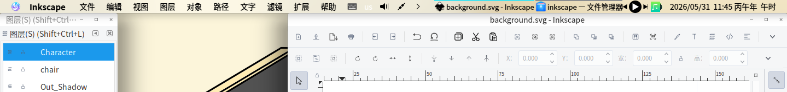
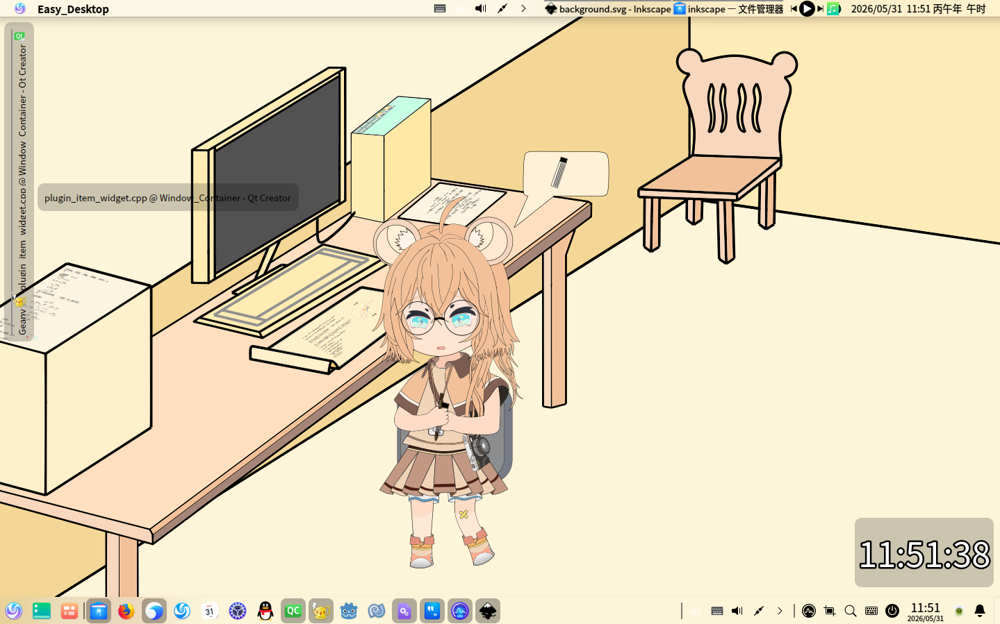

# Window_Container
一个插件,可以作为一个临时的任务栏

基于Ext_Plugin_Interface(dde-dock插件变体)

所以不仅Easy_Desktop ,dde-dock和dde-top-panel也能加载该插件,只是插件需要做一些专门的处理(主动句)

(简单说一下:当dde-dock和dde-top-panel加载该插件时,插件会通过启用/禁用自己以刷新自己在dock/top-panel中的视图. 具体怎么做,看源码中的注释)

## 截图

